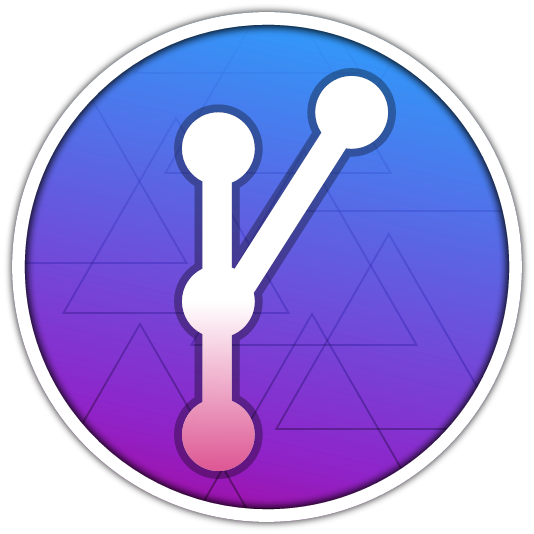

<h1 align="center">
  
</h1>

# Patchsu is self-compile osu!lazer with local-first priority client that has extra optional features

### If you just stumbled upon this repository and don't know what osu!lazer or osu! is -> go and play official client instead of this at https://osu.ppy.sh/ !!!

1. **Respect what osu!team does and how good their code is. Most of those AI shenanigans are only available because of how thought out human-written code is. AI could never do this or that quickly without them.**

2. Patches provided do not break any rules of osu! that are stated on the wiki or MIT licensing, **HOWEVER**, **I HIGHLY ADVISE DO NOT RETURN SCORE SUBMISSION FUNCTIONALITY ON YOUR OWN**, because after patches **this will count as third-party client**, and logging into third-party clients for this is dishonest and is technically unnecessary strain on osu!servers. Despite this, those patches are provided for, subjectively, *better* user experience and different improvements on the game.

3. **I DO NOT recommend using this as main client**, unless you prefer local-focused play / banned, or just to fuck around with new mods/features. I update things pretty frequently for now, because I use it every day until my hyperfixation goes away (then it'll enter maintance state)

4. Client does not connect you to any server but official osu! one if **you** login into your account. You can create patches to connect to other servers/accounts as well and submit them as pull request if you want. 

5. I know how Peppy treat AI, however this repository is 95% AI driven anyway because I'm not familiar with programming besides few .sh scripts, but I do read code trying to understand it and test every feature A LOT for things to be polished and working. I'm not a programmer and never claim to be one, I just want to try things out and implement as much features as possible that are scattered between different clients in one so it would feel fun to play for me. I try to treat it responsibly and actually think about features A LOT before actually asking to implement them as well as making mock-up designs firstly (Need to do mod icons still).

## TL;DR
### Showcase video below; [click for Showcase screenshots](screenshots/)
No video yet, you've found/got recommended this repo while its still in its earlier stages

*put video here*

### [Everything these patches implement](PATCHES.md)
### [Download CLI tool that will set everything up for you automatically](https://github.com/PorkingMane/Patchsu/releases).
Takes ~2 minutes max if you have medium-power PC, but this needs to be done only once.
I know that people hate when they need to research and do stuff when they just want to try things out, so there is also a GOLang based CLI tool that will guide you
through everything you need to do and a short description of every patch if you forget something. Should work on every system, but tried only on Linux because
that's what I run.
### [How to contribute/suggest stuff](CONTRIBUTING.md).
Or join discord on top of this README!!!

# What this repository is

Those are .patch files for osu!lazer open-sourced (that will stay that way, hopefully) client that you need to compile yourself on your end via provided .sh/.cmd files in release tab or downloading entire repository yourself and opening said .sh/.cmd files. You can mix and match those patches any way you want to create personal experience or to add things to the game you always wanted, but are too far along on ppy team roadmap. Right now most of the features are aimed on a local-based play because of personal reasons, but this will expand in the future (hopefully), as well as you can submit your own patches on top of what already provided in the repo via Pull Requests, see [CONTRIBUTING.md](CONTRIBUTING.md).

### My incentive to do another 'github repo slop' when there is infinite amount of other clients
Everyone is making a their own fork of the client/server to implement features that they want, which on itself is a good thing, because people are trying stuff out, but having so many of the same 'private servers' or 'forks' that do mostly the same thing is kinda boring and repetitive, especially in the age of AI when you can iterate features faster than ever. I don't want for lazer to go close-sourced (as a possible consideration was stated in [this](https://youtu.be/hxz6ieZx_jQ) osu!update video), because experimenting and people trying stuff they want is the utmost priority to keep community healthy, no matter if the things are done with AI or not.

Instead, I'd love to actually experiment on my own and .patch stuff on top of base osu!lazer if that fulfills both osu!team (to pace at their own, implementing carefully crafted features without any AI) and community/mine (fuck around and do cool stuff that are fun to play with / can help people get better mentally or skill-wise) desires.
I think its a fair game as long as people don't annoy each other and act reasonable... Also I hate stable (stable is almost the same age as me bruh), McOsu is really old as well, and many clients do not update/keep up with lazer rather going their own path, so idea of .patch files that can be split up and built differently feels a lot better to me than dividing the community into many forks that serve different purposes (I'm aware that this repo will only contribute to this problem with 99% certainty either way, but I'll try to maintain it as long as possible).

## Patch logic
Every patch is dependent on 0001-Offline-Fix because NO WAY we should send any updates to your actual osu!profile, even if there is in-game protection from this, especially with how many patches there are. If you modifying the patches and removing this line, or you asking AI agent to do so - its on you, and I would HIGHLY advise not to.

Patches are stackable against each other. Patches with B or even C that becomes available if you apply patches that those depend on, because its a multilayer change in osu! code

Most patches are small and tweak little things, like few UI changes, but, for example local-profiles are really big and will force your computer to compile for longer time.

Patches are updated separately if possible, but to successfully test if it compiles I suggest testing it with minimal and maximum required of patches possible.

Patchsu uses the official osu! data folder (`~/.local/share/osu`, `%APPDATA%\osu`), so your beatmaps, skins and scores are shared with the official client. Patchsu's own data (settings in `PatchsuSettings.json`, local profiles, caches) lives in its `patchsu-osu/` subfolder (called `osu-local/` before; it is renamed on the first start). Only one of the two clients can run at a time.

### Most notable things implemented
All things documented here already can be compiled via provided .sh / .cmd files (or CLI tool in release tab) and are heavily tested.

 
 1. Disabling almost* every connection and multiplayer feature from client. 

  
  - *Beatmap downloading/updating and discovering works
  - *Beatmap metadata updating on launch works
  - *Pulling leaderboards works
  - *Profile look up from leaderboard works
  - *Replay downloading from leaderboard works

 
 2. Fully local profile page with every 'offline-lable' statistic and more... 

  - Re-linking scores to local profile if the name are matching in database (think osu!stable local plays that you can suddenly submit to your account and manage from there)
  - Deleting every score with local profile deletion from database
  - Locking out profile with custom mod combinations and settings (you won't be able to pick any mods but the ones you selected when creating profile, configurable after creation through profile UI)
  - Mod auto-equip based on profiles
  - Auto-profile change when entering a beatmap with a specific tag / bpm / star rate / length *(if you are OCD pilled)*
  - Local beatmap tags submission after completion (because not every map tagged properly)
  - Estimated Global Ranking based on profile current PP (*yoinked from https://github.com/Azuuryy/ritsu*, snapshot was taken in September 2026)
  - Obligatory Relax/Autopilot PP, because everyone do that lmao
  - Ignoring 'Unranked' mods status. Toggling this will only affect mods that makes plays count as Unranked. Unranked maps are still unranked
  - 'Everything is ranked mode' to match McOsu and Mosu. Every map counts as ranked on that specific profile / all profiles
  - Online lookup from Local account so you don't have to switch between official and local one
  - 'Sudden Death' option, profile will automatically be deleted whenever you miss. Auto-deletes after 30 seconds (or a minute, in settings) / right after you close profile GUI *(yt content)*
  - 'Perfect Death' option, SD but PF *(yt content 2)*
  - 'Speedrun' option, set a PP or #rank goal and a timer counts how long the profile was active until you reach it
  - Importing replays as selected profile DIRECTLY in osu! database
  - PP exclusion for selected score/beatmap/mapset
  - Exporting top 50 / every score recorded on local profile

 
 5. Few interface adjustments that stays true to osu!lazer UI

  - Reversed sorting
  - PP sorting
  - Right-clicking / Dragging on Star Rating bar will move the furthest end to your cursor (mirroring how LMB works)
  - Wheel clicking resets Star Rating bar
  - Wheel clicking on 'Now Playing' mutes music
  - Removed 'Play' and 'Clear all local scores' from Options/F3 (The one on the bottom bar) menu.
  - Holding Shift whenever there is a text in search box allows you to move it by 1 symbol.
  

 
 7. Togglable mods in replays

  
  - **Vanilla osu!lazer**
    - Half-Time / Daycore
    - Double Time / Nightcore
    - Hidden / Traceable
    - Flashlight / Blinds
    - Wind Up / Down
    - Grow / Deflate
    - Muted
    - No Scope

**Ritsu/Torii/McOsu mods** has this functionality built-in their respective patches

8. Full in osu!lazer UI (result screen) PP simulation. See [screenshots](screenshots/) folder for preview

 
 9. McOsu mods

- **Mafham** ported to lazer in a usable, optimised state, with an option to disable it in replay so you can see exactly where you've missed AND with culled object brightness slider (if you don't want to learn the map, but still play Mafham for fun. Check [screenshots](screenshots/) for preview)
- **Jigsaw 1**, that is now called 'Click Control'. Any unnecessary clicks count as misses and can go past object count.

# Documentation
[GUIDE.md](GUIDE.md) - if you want to build stuff yourself instead of my CLI tool and some caveats about it. AI written

[PATCHES.md](PATCHES.md) - every patch, what it needs and what it does.

[CONTRIBUTING.md](CONTRIBUTING.md)

[CHANGELOG.md](CHANGELOG.md) - AI compiled for now

[AGENTS.md](Agents/AGENTS.md) - if you let an AI agent update/do anything, point it here

# License
This patch files use the MIT license, which matches the license of the upstream client (osu!lazer).
**Exception:** the Modosu-derived mods in `0500-Ritsu-Mods.patch` are GPL-3.0 (the patch adds `LICENCE-Modosu.txt` to the tree), so a build that includes 0500 is GPL-3.0 as a whole.
See [LICENSE](LICENSE) for more information
