# Screenshots

| | |
|---|---|
| 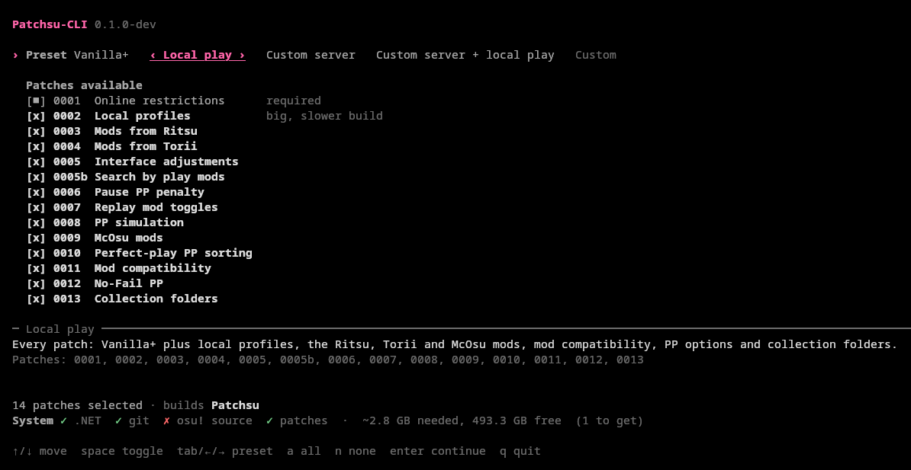 | **Patchsu-CLI-Installer**: Select patches you need or use available presets. |
| 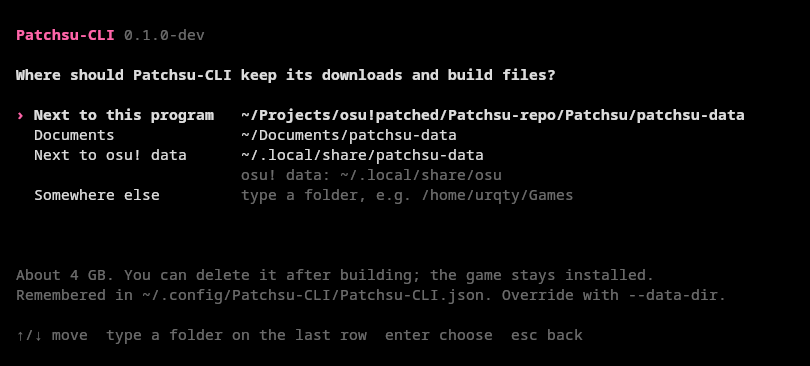 | **Patchsu-CLI-Installer** |
| 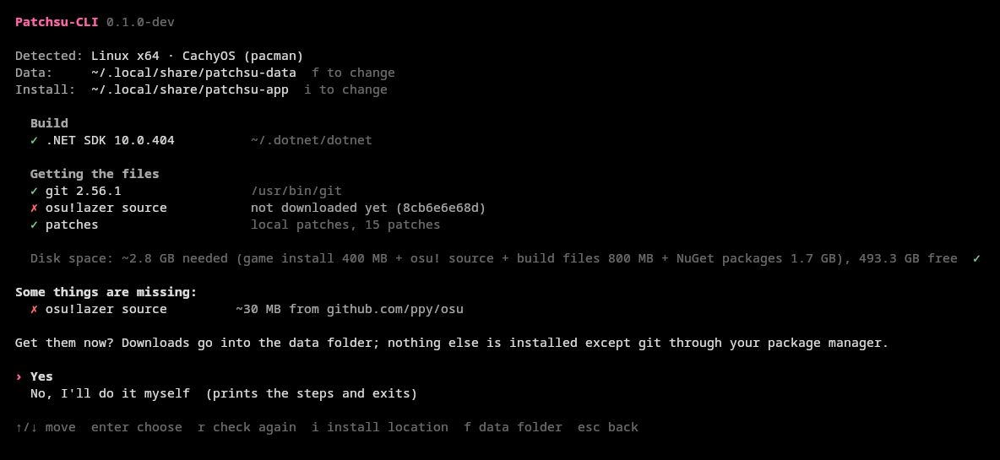 | **Patchsu-CLI-Installer** |
| 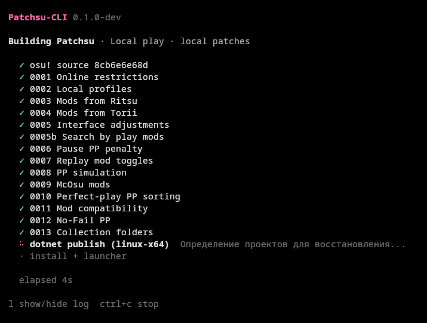 | **Patchsu-CLI-Installer** |
| 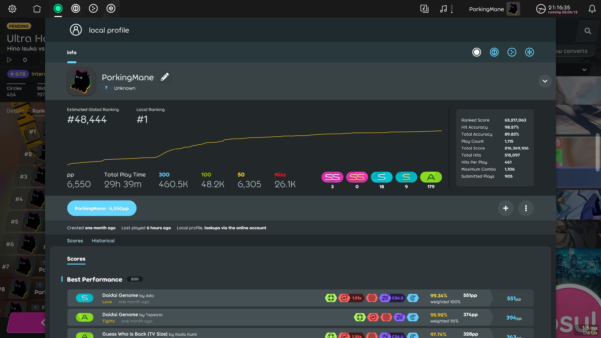 | **Local profile page** (0002): estimated global rank, PP history, statistics, best scores. |
| 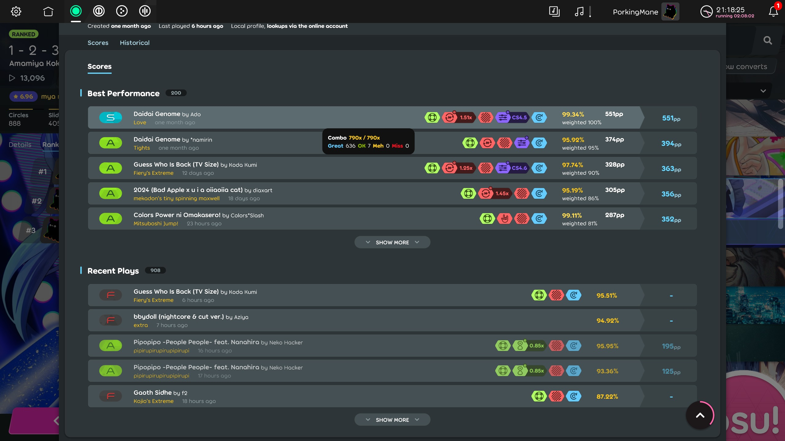 | **Scores** (0002): best performance and recent plays, failed / quit plays shown as F, judgement tooltip. |
| 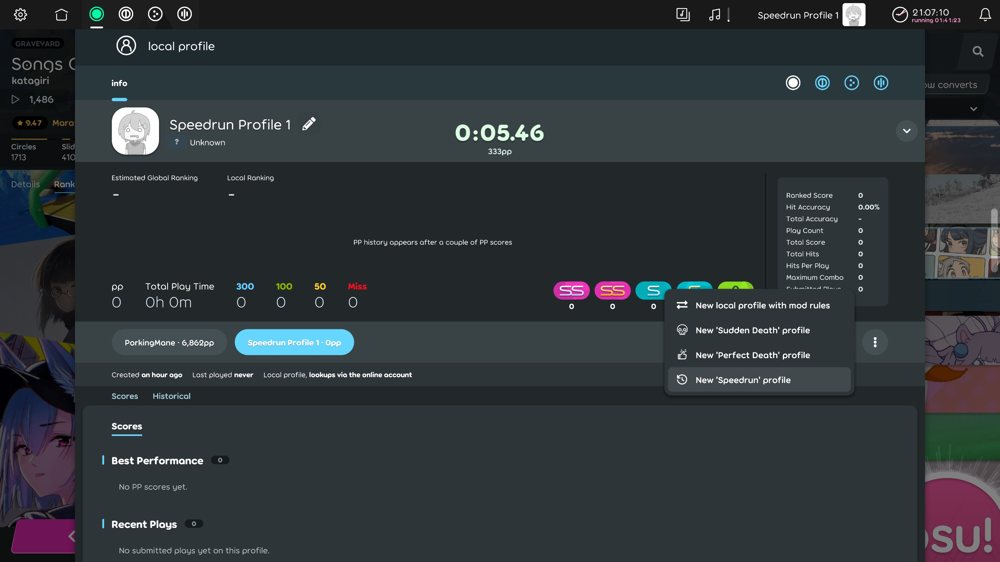 | **Speedrun Profile** (0002): Enter amount of PP/E.Global rank you want to speedrun for and it will track it for you.|
| 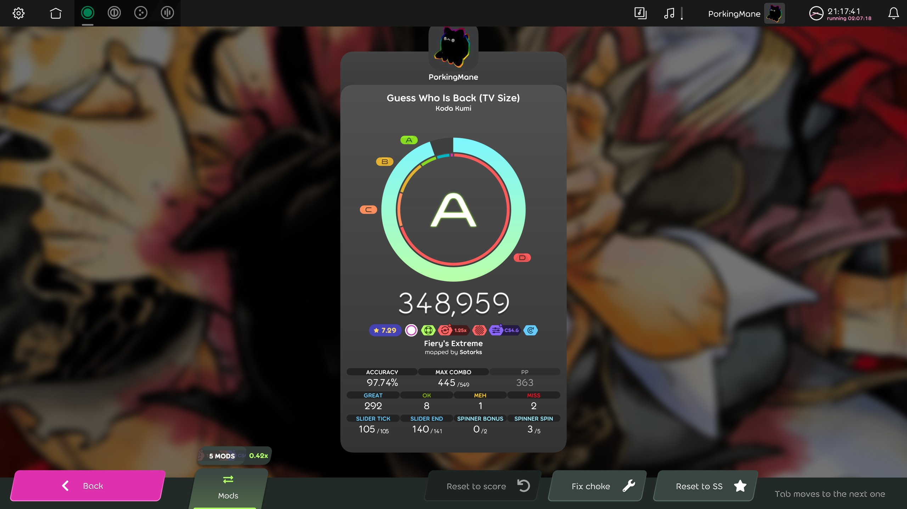 | **PP simulation** (0006): type into any number; Fix choke, Reset to score / SS. |
| 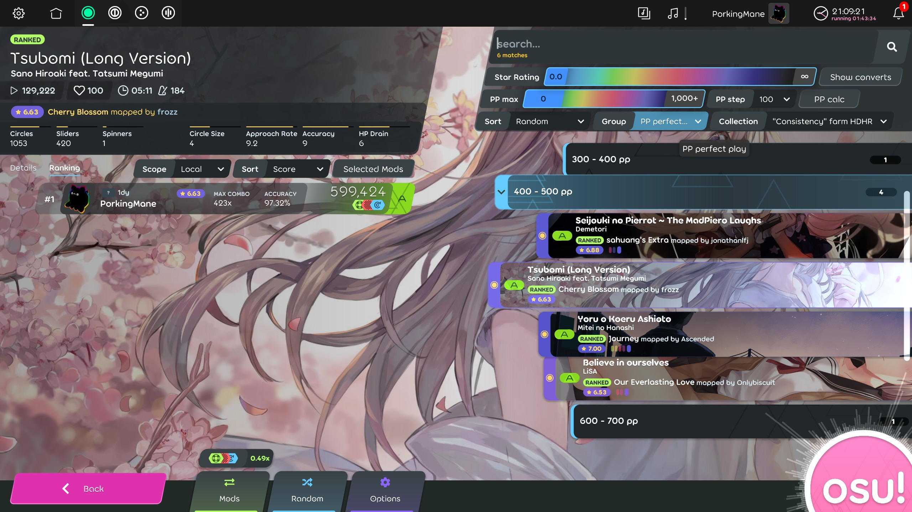 | **In-game PP grouping + Random sorting** (0003 + 0007): You can calculate PP for all maps with your current mod combination and group it by achiavable PP with SS, also Random Beatmap Sorting with F2 algorithm |
| 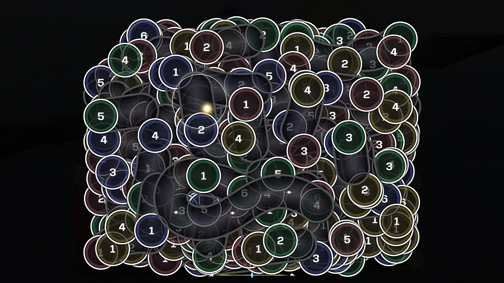 | **Mafham mod ported to lazer** (0502): Yay! |
| 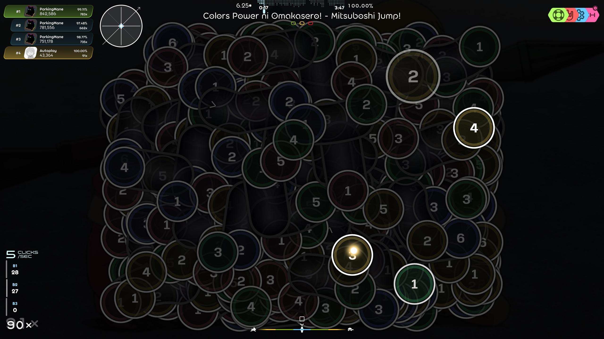 | **Mafham mod ported to lazer** (0502): Mafham mod with reduced background circles opacity to 30% |
| 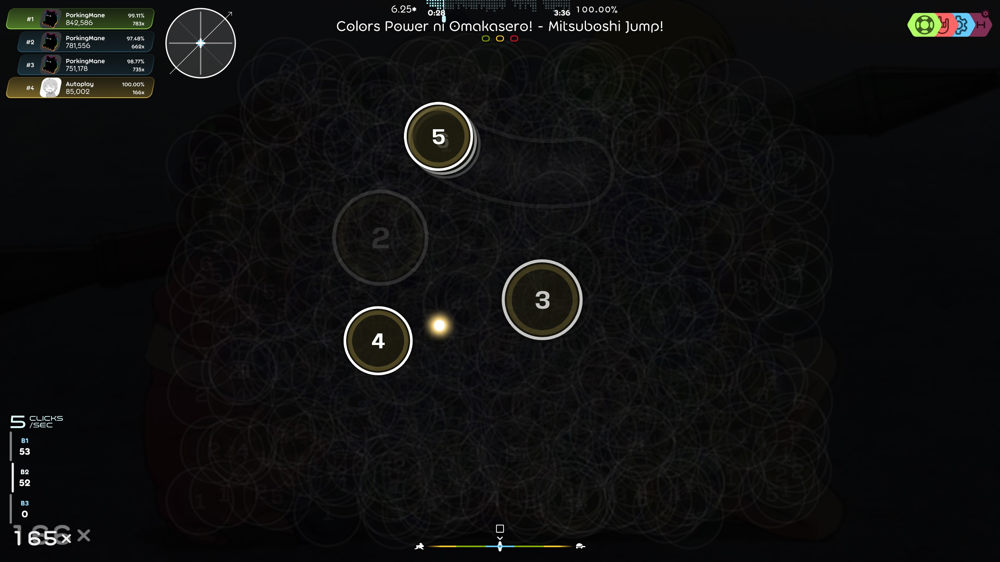 | **Mafham mod ported to lazer** (0502): Mafham mod disabled in replay view, reducing background element opacity to 10% |
| 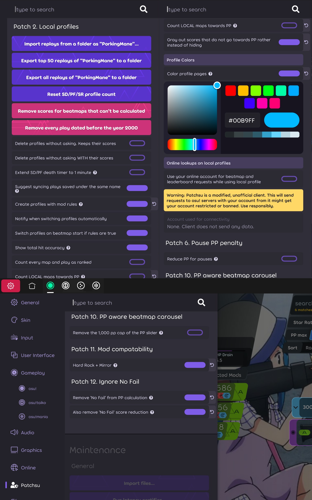 | **Every setting from every patch** (*) |
| 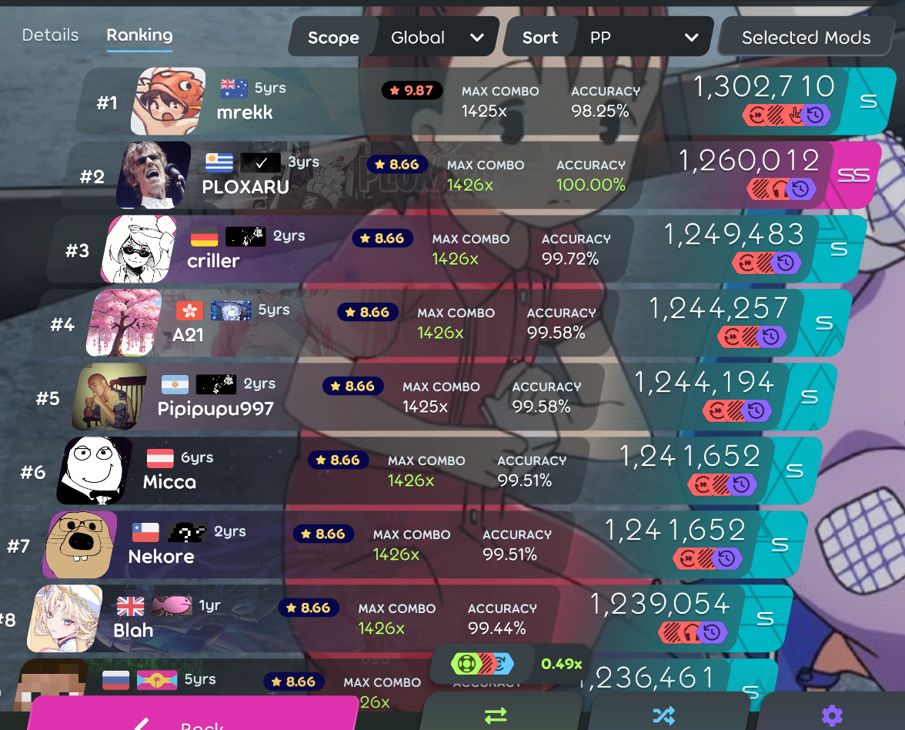 | **UI Adjustment patch** (0003) | 
| 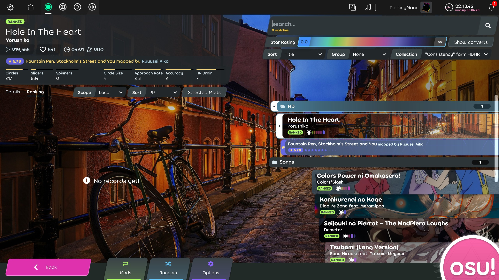 | **Create subcollections in your collections that will look like stable-ish folders** (0010) |
| 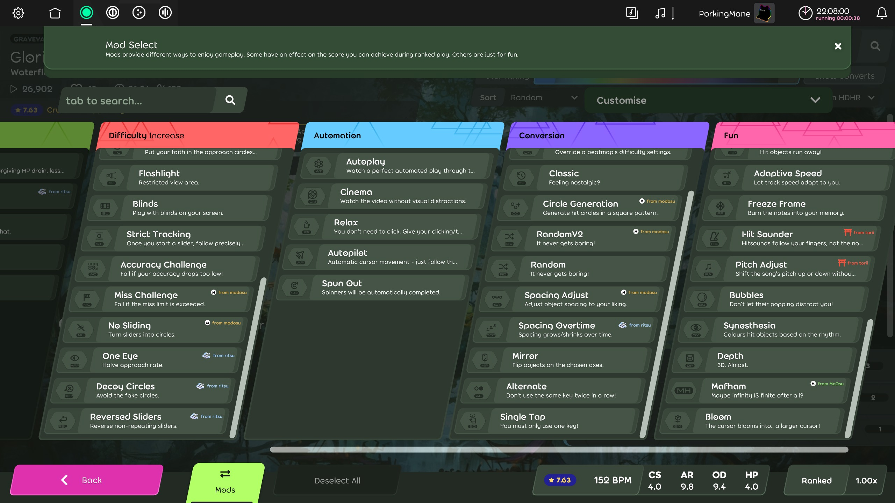 | **New, or forgotten old mods in lazer** (0500 + 0501 + 0502) |
